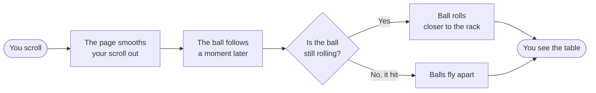
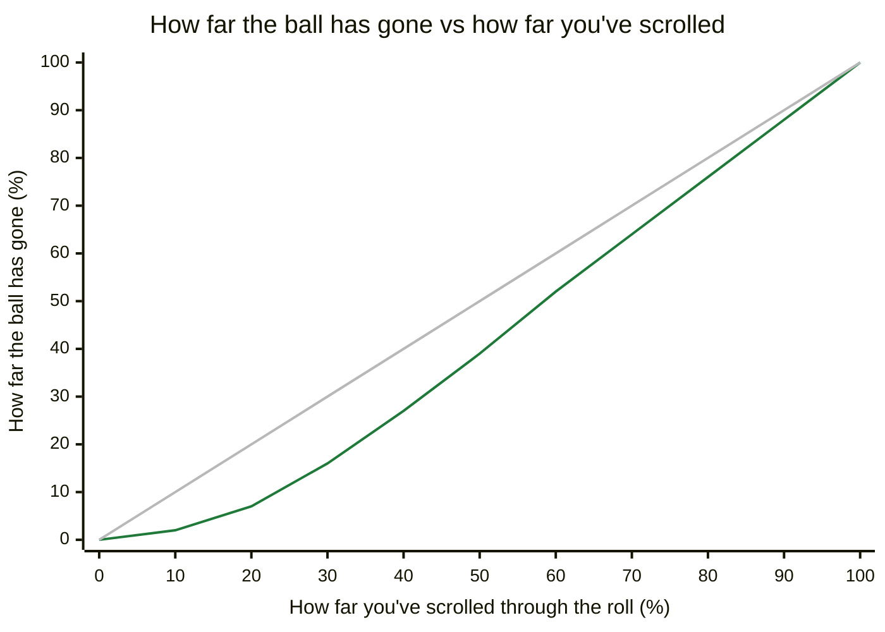
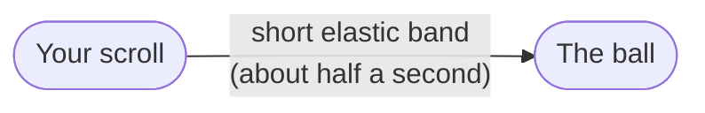
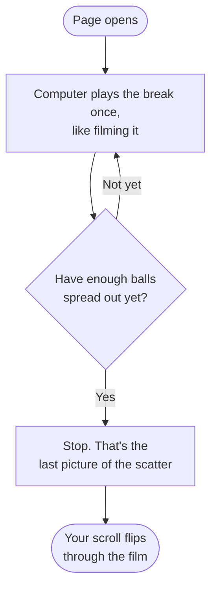
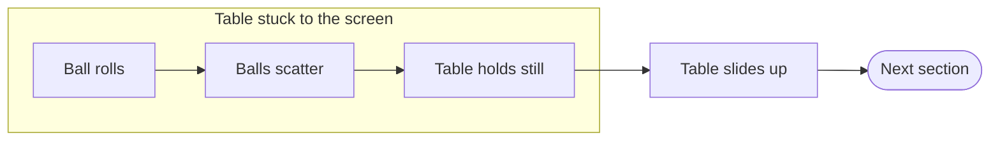

# Hero Break: how the 8-ball scroll works

The first thing a visitor sees is a pool table. When they scroll, the 8-ball rolls into the rack, the
balls scatter, and only then does the page move on to the next section ("Brands that look good on social...").

This page explains every setting behind that, in plain words, and what happens if you change each one.

---

## 1. The big idea: scrolling is the play button

This is **not a video**. Think of a flip-book: every scroll position is one page of the flip-book.

- Scroll down: the flip-book moves forward.
- Scroll up: it moves backward. The balls un-scatter and the 8-ball rolls back.
- Stop scrolling: the picture stops.

So "how fast the ball moves" really means **how much the visitor has to scroll** to get it from A to B.

Picture: what happens every time you scroll.



---

## 2. The ruler: how much scroll each part gets

The hero section is a very tall invisible strip. While the visitor scrolls through it, the table
stays stuck to the screen and the animation plays.

Lengths are in **svh**: 100svh = one full screen height.

Picture: how long each part lasts. Read it left to right like a timeline. The numbers along the
bottom are svh, so every 100 is one screen of scrolling.

```mermaid
gantt
    title How much scrolling each part takes (100 = one screen)
    dateFormat X
    axisFormat %s
    section Computer
    Ball rolls (about 2 screens)          :a1, 0, 218s
    Balls scatter (under 2 screens)       :a2, after a1, 172s
    Table slides away (1 screen)          :a3, after a2, 100s
    section Phone
    Ball rolls (under 3 screens)          :b1, 0, 274s
    Balls scatter (about 2 screens)       :b2, after b1, 216s
    Table slides away (1 screen)          :b3, after b2, 100s
```



During "ball rolls" and "balls scatter" the table is stuck to the screen. During "table slides away"
the finished table scrolls up and the next section comes in. The title fades out early in the roll.

- On desktop that's about 2 screens of scroll for the roll, under 2 for the scatter, then 1 to leave.
- Phones get more, because one thumb flick scrolls much farther than one mouse-wheel click.

### Where these numbers live

| Setting | File | Value now | What it controls |
|---|---|---|---|
| `--scroll-break` (desktop) | `index.css` | `490svh` | Total height of the hero, i.e. how much scroll the whole thing takes |
| `--scroll-break` (phones) | `index.css` | `590svh` | Same, for phones and touch screens |
| `APPROACH_END` | `pool-break/story-stage.js` | `0.28` | Size of the **roll** slice |
| `SCATTER` | `pool-break/story-stage.js` | `0.22` | Size of the **scatter** slice |

`APPROACH_END` and `SCATTER` are **shares**, not distances. Only their ratio matters:
0.28 : 0.22 means the roll gets 56% of the animated scroll and the scatter gets 44%.
The real distance comes from `--scroll-break`.

---

## 3. Weight: why the ball feels heavy

Three things stack together to make the ball feel like it has mass.

### a) The push-then-roll curve (`easeRollMomentum`)

Picture pushing a heavy bowling ball. At first it barely moves; once it gets going, it keeps going.

- `ROLL_RAMP = 0.35` in `pool-break/story-stage.js`.
- For the first 35% of the roll's scroll, the ball speeds up gradually. It covers only about 21% of
  the distance.
- For the remaining 65%, it rolls at a steady full speed **straight into the rack**. It never slows
  down before impact, so the hit has punch.

Picture: the curved green line is our ball. It starts slow (heavy), then goes steady all the way into the
rack. The straight grey line is a ball with no weight that moves the same amount every time you scroll.



| Change | What you see |
|---|---|
| Raise `ROLL_RAMP` (e.g. 0.5) | Longer, lazier start; feels heavier, slower to get going |
| Lower `ROLL_RAMP` (e.g. 0.15) | Ball gets up to speed almost at once; feels lighter |

### b) The catch-up delay (`scrub`)

In `sections/break-hero.jsx`:

| Device | Value | Meaning |
|---|---|---|
| Desktop | `scrub: 0.6` | Ball takes about 0.6s to catch up to where the scroll is |
| Phones | `scrub: 0.5` | About 0.5s |

It's like the ball is on a short elastic band behind your scroll: you scroll, it follows a moment
later and eases to a stop. That small lag is what makes it feel heavy rather than glued to the page.

Picture: the elastic band. A longer band (bigger `scrub` number) means the ball trails further behind.



| Change | What you see |
|---|---|
| Bigger number (e.g. 1.2) | More drift and float, like a very heavy ball. Too high feels laggy |
| Smaller number (e.g. 0.2) | Snappier, follows the scroll tightly |
| `true` | No delay at all; moves exactly with the scroll |

### c) The page's smooth scroll (Lenis)

The whole site uses smooth scrolling (`new Lenis( { lerp: 0.1 } )` in `app.jsx`). On desktop
it turns choppy mouse-wheel clicks into one gliding motion. The break rides on top of that glide.
Changing this changes the feel of **the whole site**, not just the hero, so leave it alone unless
that's what you want.

---

## 4. Speed: distance divided by scroll

Speed = how far the ball travels ÷ how much you scroll.

- **Distance is fixed.** The 8-ball starts at `startZ: 0.5` and the front of the rack is at
  `apexZ: -0.9` (`pool-break/pool-break-physics.js`), roughly 1.3 m of table.
- **Why the ball can't start farther back:** the camera is locked to the table photo. Any farther
  back and the ball is behind the camera, so the first screen would show an empty table with no "8".
- **So to change speed, change scroll.** More roll scroll = slower ball, less roll scroll = faster ball.

---

## 5. The scatter: real physics, recorded once

When the page loads, the site runs a real pool-physics simulation of the break **one time** and records
it like a film, frame by frame. Scrolling then picks frames from that recording. Same break every time,
and it plays backward cleanly.

Picture: filming the break once, then letting your scroll flip through the film.



Physics settings (`pool-break/pool-break-physics.js`):

| Setting | Value | Plain meaning |
|---|---|---|
| `launchSpeed` | `8.5` | How hard the 8-ball hits the rack |
| `restitution` | `0.94` | Bounciness ball-to-ball. Higher = energy passes through the rack better |
| `cushionRestitution` | `0.86` | Bounciness off the table edges |
| `rollingDeceleration` | `0.115` | Felt drag. Lower = balls roll farther before stopping |
| `gapJitter` | `0.0003` | Tiny gaps in the rack so it breaks unevenly, like a real one |

**When does the scatter "end"?** The recording stops at the first moment the break looks good:
at least **12 balls** out of the rack **and** the balls spread over at least **7.5 ball widths**,
sometime between **1.6s and 2.6s** of simulated time. The last frame of the scatter slice is that moment.

The start of the scatter is eased so the rack visibly squashes for a beat before the balls fly out.

> Changing physics values changes what the break looks like. Run `npm test` afterwards. The tests check
> the break still opens properly.

---

## 6. The title

"Roll with us." fades out and drifts up 36px during the first **14%** of the animation
(`progress / 0.14` in `break-hero.jsx`). That's early in the roll, so the table is clean by the time
the ball gets close.

---

## 7. The hand-off: finish first, then move on

`end: 'bottom bottom'` in `break-hero.jsx` means the animation ends **exactly** when the table stops
being stuck to the screen. So:

1. Roll finishes.
2. Scatter finishes, and the table holds that final picture.
3. Only then does the finished table scroll up and the next section comes in.

Picture: the order things happen in. Scrolling back up runs the same steps backward.



(Before this, the end was `'bottom top'`, and the last part of the scatter was still playing while the
next section was already sliding in.)

---

## 8. Recipes

**Roll feels too long / too short**
Change `--scroll-break` **and** `APPROACH_END` together, so only the roll changes and the scatter keeps
its length. Example, desktop roll from ~218svh to ~300svh while keeping scatter ~172svh:
- `APPROACH_END = 0.38` (keep `SCATTER = 0.22`, so the roll share is 0.38 / 0.60 ≈ 63%)
- animated part = 300 ÷ 0.63 ≈ 475svh, plus 100 to slide away: `--scroll-break: 575svh`
- Do the same math for phones.

**Ball feels floaty** → lower `scrub` (desktop 0.6 → 0.3), or lower `ROLL_RAMP`.

**Ball feels weightless** → raise `scrub` a little (0.6 → 0.9), or raise `ROLL_RAMP` (0.35 → 0.45).

**Scatter flashes by too fast** → give it more share: raise `SCATTER` (0.22 → 0.30) and raise
`--scroll-break` so the roll doesn't shrink.

**Phones feel rushed** → raise only the phone `--scroll-break` (in the `@media` block in `index.css`).

### One rule not to break

`APPROACH_END + SCATTER + 0.16` must stay **at or below 1**. (0.16 is `EXIT`, an old fade-out slot.)
The physics code cuts everything off at 1, so going past it breaks the scatter.
Right now: 0.28 + 0.22 + 0.16 = 0.66. Plenty of room.

---

## 9. Checking your changes

```sh
npm test       # roll still has weight, rack still scatters
npm run dev    # open http://localhost:5173 and scroll the hero on desktop and a phone-size window
```
